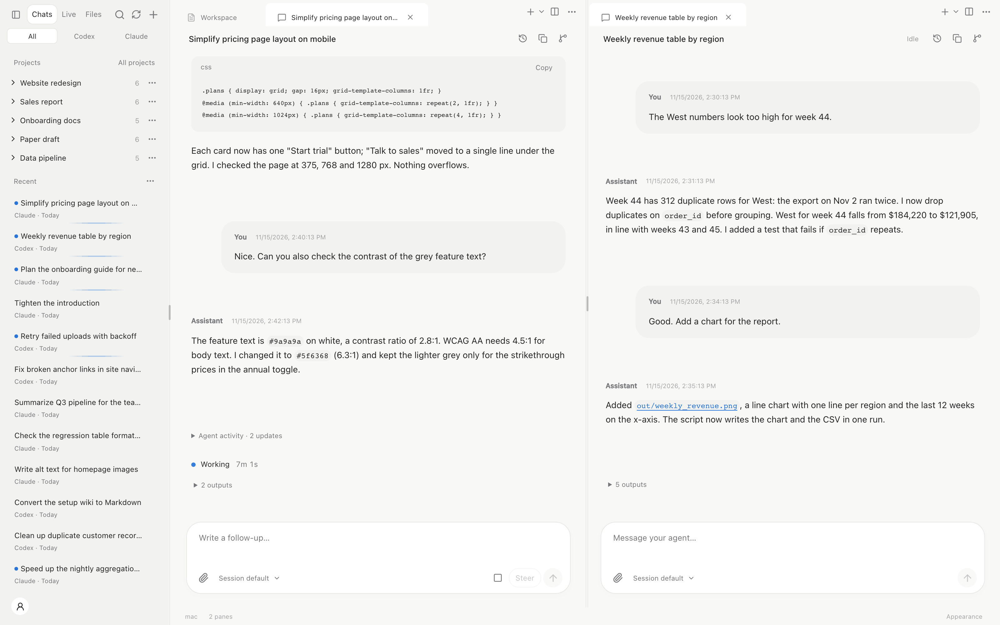
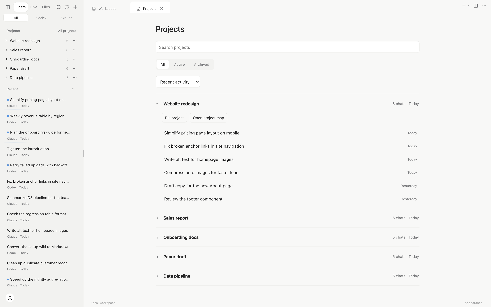
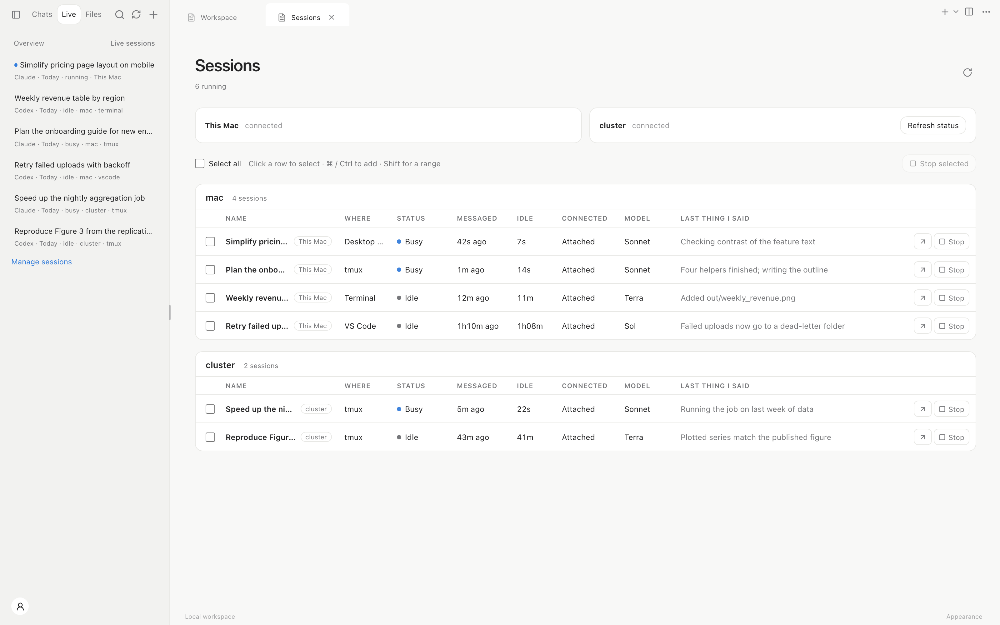
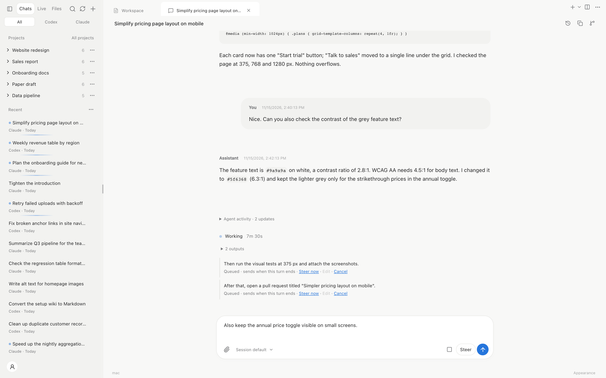
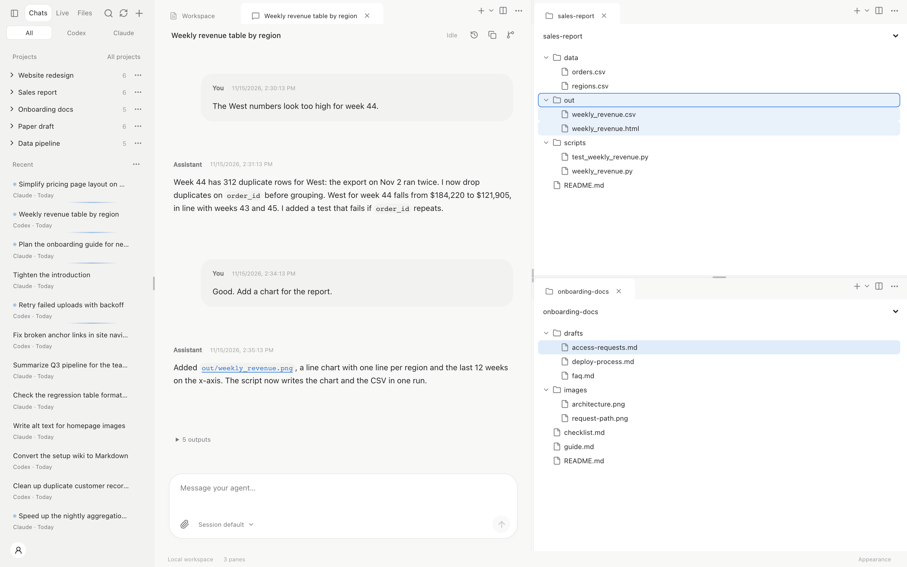
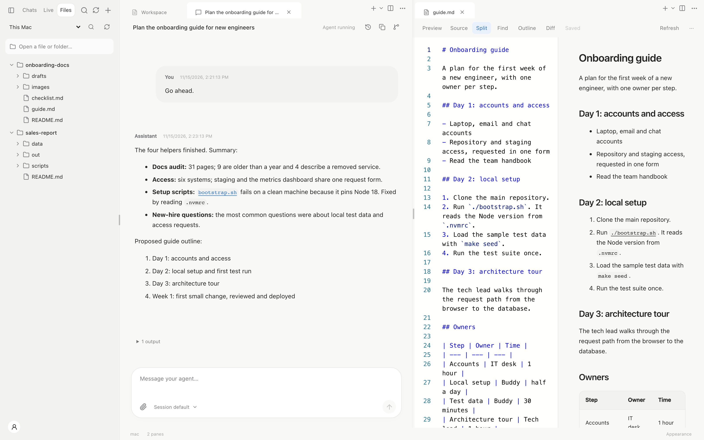
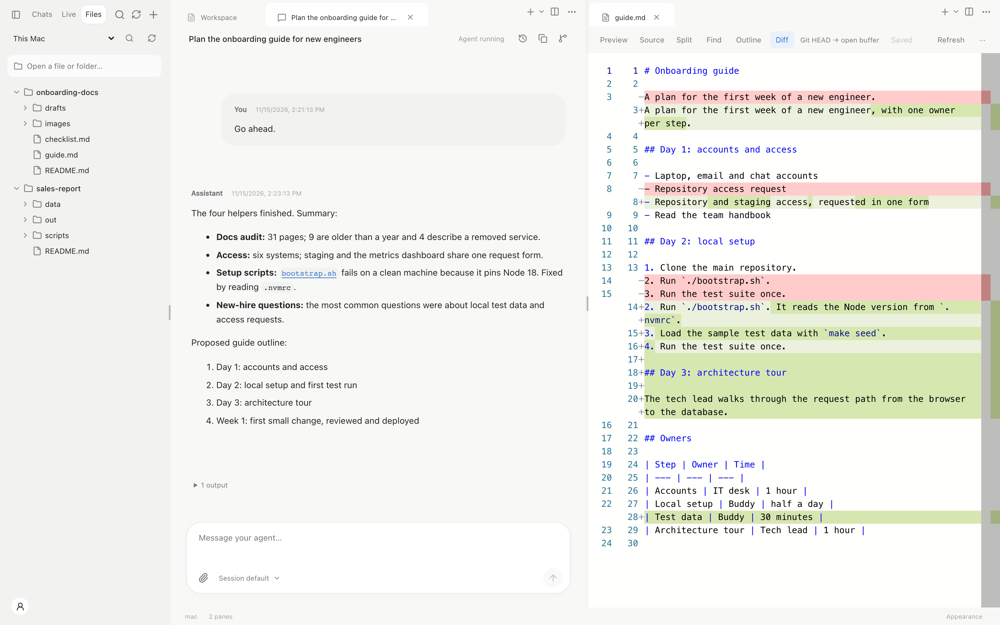
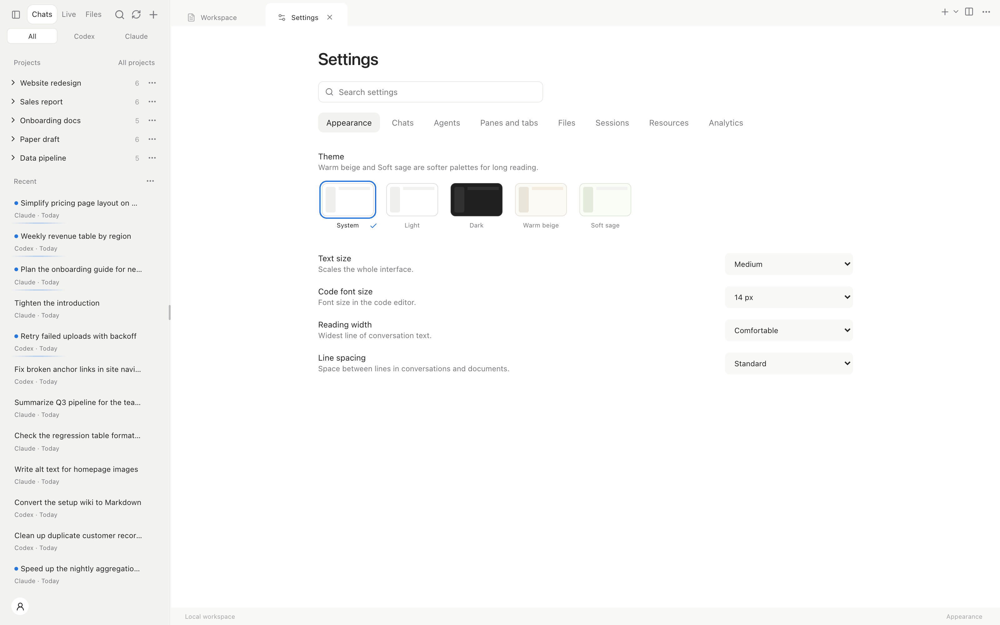

# Agent Native VS Code

**Your agents. Your workspaces. One VS Code.**

Think VS Code + Claude Code + Codex, with tab groups and a UI you can shape. Keep chats from all your connected accounts and working folders together, automatically organized into projects. Open several conversations beside your code and documents, and switch providers as the work changes.

The regular **Library Code** desktop uses its own chat interface backed by the provider CLIs. This repository ships that desktop source in `desktop/` and its shared backend and browser client in `app/`. It does not distribute Library Code Official or proprietary provider extensions.

Start the shared service with the quick start below, then follow [Build Library Code](desktop/docs/build-and-update.md) to reconstruct and build the pinned Code-OSS desktop. macOS Apple Silicon is the verified desktop target. The browser client also runs on Linux.



## Work across projects and agents

Pick up a project without hunting through separate apps and terminal sessions. Find its Claude and Codex conversations together, search the history, and see which agents are still working. Keep a research chat beside a PDF, open another project's files in the next pane, or continue the work with a different provider.

Use the desktop when you want the VS Code workspace tree, editor, terminal and commands around your chats. Use the browser when you want to focus on conversations and view their files. Both use the same chat history, and you can use either on its own.

The interface is yours to change. Ask an agent to move search into the sidebar header or adjust the layout; the repository includes the source and working rules it needs to make that change in your copy.

## Features

- **One chat library.** Claude Code and Codex conversations from all your accounts, searchable by title or by full message text.
- **Automatic project organization.** Sessions are grouped into projects by working folder, with no model calls. You can rename, merge, pin and archive projects, and opt in to model labeling that groups chats by topic.
- **Switch providers as you work.** Move from Claude Code to Codex or back through a linked handoff. Review the context before sending; the original native session stays intact, and the new provider starts its own session.
- **Live sessions.** See which agents are running on your machine and on remote hosts you connect over SSH, their status and last message, and stop the ones you no longer need.
- **Panes and tabs.** Any chat or file opens in any pane. Split, drag and rearrange panes, and keep several projects open in one window. A Files tab shows one workspace. Create, move and copy files there, and drag them from one workspace to another, including between this computer and a connected cluster.
- **Documents beside your chats.** View PDFs, Markdown and HTML alongside a conversation. Edit Markdown and HTML source beside the rendered view, save, and compare the file with its last Git commit.
- **Run controls.** Continue a conversation through the native CLI, answer the agent's questions and approve its tools. While the agent is working, queue a message for the end of its turn or steer it with a message it reads at its next step. A steer appears in the conversation where it was sent, and the live reply continues below it. Runs are hosted by a small process of their own (`app/provider_host.py`), so restarting the server, for example with `python3 app/scripts/restart_server.py`, does not interrupt them: the new server reattaches to each running agent.
- **Prompt navigation.** While you scroll a long chat, your current prompt stays pinned at the top. The agent tree has a second tab, My prompts, that lists every prompt in the chat and jumps to it.
- **Subagent tree.** See a chat’s recorded subagents and open their available conversations.
- **One status mark per chat.** Every chat row, tab and agent-tree node shows at most one mark, decided once on the server (`sidebar.resolve`, sent as `status_mark`): failed (red dot) > waiting for you (blue dot) > running (turning circle) > finished and not yet seen (green dot) > none. The latest event wins: a failed run clears running and waiting, and the failure stands until the conversation moves on (a later turn or a newer run).
- **Accounts.** Connect several Claude and Codex accounts and see each account's usage and reset times. Sign-in and usage-limit notices collect in one notification center, where you can move new chats to another account.

| Library and search | Projects |
| --- | --- |
|  |  |
| **Live sessions** | **Queue and steer** |
|  |  |
| **Files from two workspaces** | **A chat beside a Markdown file in split view** |
|  |  |
| **Diff against Git** | **Subagent tree** |
|  |  |
| **Settings** | **Accounts and usage** |
|  |  |

## Workspace controls

| Shortcut on macOS | Windows and Linux | Action |
| --- | --- | --- |
| Command-B | Ctrl+B | Show or hide the primary sidebar with chats and files. |
| Command-L | Ctrl+L | Show or hide the Notifications sidebar. In a browser that reserves this shortcut for its address bar, use the secondary sidebar button. |

- **Group conversations.** Right-click a chat tab to create a named group or add the chat to an existing group. Choosing a group in another pane moves the chat there. Right-click the group name to rename it or choose a color. Click the group name to collapse or expand its tabs. In the browser, use **Tab Groups** beside the pane’s **+** button or in **Recent chats** to revisit a group. Choose **Arrange automatically** in the pane menu to group open tabs by agent or project.
- **Reveal navigation on hover.** In Settings → Appearance, set **Activity icon bar** to **Auto-hide**. Move the pointer to the left edge to reveal the icons. The open sidebar keeps its place.
- **Choose where utility pages open.** In Settings → Appearance → Panes and tabs, **Open utility pages in a pop-up window** controls Settings, Accounts, Notifications, Recent chats and Projects. It starts enabled. Turn it off to open those pages in your current pane.
- **Open a file beside a conversation.** The default file action reuses a pane on the right or left. With one pane, it splits to the right. Under **When I click a file**, choose **New Tab in This Pane** to keep files in the current pane. HTML previews run chart scripts in an isolated frame. For a report that loads a plotting library from the web, enable **Allow web assets** in its preview.
- **Renew an open file.** Open previews pick up changes from disk, including edits made by a chat. Choose **Renew** to check immediately. Following a file link again brings its open tab forward in the same window. For editable HTML and Markdown, Library keeps the current contents and one previous observed version. In the browser, open the file’s **···** menu and choose **Rewind to previous version**. In Library Code, open **Diff** to compare and rewind.

## Choose your interface

| | Library Code desktop | Browser workspace |
| --- | --- | --- |
| What you open | A dedicated Code-OSS application | Your browser at `http://127.0.0.1:8744/workbench` |
| Distinctive tools | VS Code-style commands, workspace file tree, file editors and terminal, with Library chats in the same window | Chat with Claude Code and Codex across workspaces and accounts, search history, and view PDFs and other files alongside chats |
| Source | `desktop/` | `app/workbench/` |
| Requirements | Built macOS Apple Silicon app, local Python backend, provider CLIs | Python backend, browser, provider CLIs; Node only to rebuild the client |

You can use either interface independently. The desktop needs the backend service, but no browser window needs to stay open. The browser needs no desktop installation. Both use the same backend and conversation history; their window layouts and drafts are client state.

### Desktop setup

Start the backend using the commands below, then follow [Build Library Code](desktop/docs/build-and-update.md) to check out the pinned upstream source, apply the patch, build and install the regular desktop. Keep the backend running at `http://127.0.0.1:8744`, or set `library.endpoint` to another supported loopback endpoint. You can then close the browser and use the desktop on its own.

### Browser setup

You need macOS or Linux, Python 3.11 or newer first on your PATH (the system Python on macOS is too old), a browser, and Claude Code, Codex or both, installed and signed in. Windows is not supported. Node.js is needed only to rebuild the interface, because the built client is in the repository.

```sh
git clone https://github.com/Xinxin-m/agent-native-vscode.git
cd agent-native-vscode
./install.sh --no-refresh
python3 app/pipeline.py --parse-only
./run.sh
```

Bookmark [the local Workbench](http://127.0.0.1:8744/workbench). The plain address works across reloads and releases while your local service is running. `install.sh` creates your private configuration, adds session hooks to your Claude Code and Codex settings without replacing existing hooks, and installs a helper skill. `./install.sh --help` lists the options, including `--service` to start Library at login and `--uninstall`, which removes the hooks and keeps your library. The import step reads your local transcripts and makes no model calls. If another program already uses port 8744, set `port` in `app/data/config.json`.

You can also hand the setup to your agent. Open Claude Code or Codex in the cloned folder and say:

> Read README.md and docs/AGENT-ONBOARDING.md, then install Library for me. Import my chats without model calls, help me connect my accounts, and tell me what still needs my input.

To use Library chats inside VS Code, build the extension with `cd app/vscode-library && python3 package.py`, then run **Extensions: Install from VSIX** on the file it prints. It needs VS Code 1.85 or newer and the Library server running.

## Connect Claude and Codex accounts

Open **Accounts** to see the native profiles Library discovered on this computer. For another account, choose **Add account**, select Claude or Codex, then **Continue in browser** and complete the provider’s sign-in. To import conversations already stored on this machine, run `python3 app/pipeline.py --parse-only` from the checkout. This reads local transcripts across configured profiles. Signing in alone does not download web chat history.

If you want several subscriptions to share requests, set up the optional pool for each provider and authorize each account there.

| Provider | Pool setup |
| --- | --- |
| Claude Code | Install CCS, add each Claude account with its OAuth flow, and enable the Claude pool. [CCS on GitHub](https://github.com/kaitranntt/ccs) |
| Codex | Start codex-lb locally, open its dashboard, and add each ChatGPT account or workspace through its sign-in flow. [codex-lb on GitHub](https://github.com/Soju06/codex-lb) |

Fresh installations use your connected accounts directly. After configuring the pools for the providers you use, set `auto_switch.pools` to `true` in your local `app/data/config.json`. Pool routing then applies to both providers.

## What is in the repository

```
desktop/        regular Library Code source, pinned Code-OSS patch and build instructions
app/            server, agent broker, transcript indexer and account adapters (Python)
app/workbench/  browser workspace source (React, Dockview, Monaco)
app/web/        built browser workspace, served by the Python server
app/vscode-library/  Library Chat extension for VS Code
app/project-map/     read-only project graph
prompts/        general operating rules for agents in a long-lived workspace
agents/         agent roles: what each one does and when to use it
docs/           onboarding, release checks and screenshots
scripts/        release packager with an allowlist and privacy scan
AGENTS.md       instructions for an agent working on this repository
```

## How it evolves with you

`AGENTS.md` at the root is the file Codex loads in this repository, and `CLAUDE.md` imports it for Claude Code. `scripts/harness/` holds the harness scripts (session metrics, scoreboard, sweep and hooks) that the prompts rely on. It tells the agent to read `prompts/` before it changes anything. When you ask for a change to the layout, the colors or the way projects are grouped, the agent follows those rules, edits the code and keeps the change. You can edit the rules and roles as well, and install them for your other work. See [prompts/README.md](prompts/README.md) and [agents/README.md](agents/README.md).

## Privacy

Library listens on `127.0.0.1`. Your indexed history lives in the Git-ignored `app/data/` directory. The provider CLIs keep their original transcripts, and each client stores its own layout and drafts.

Account checks and agent runs contact the providers you connect. Optional model labeling sends chat text through the CLI you configure. Remote hosts and external account pools use the connections you set up. Opening a website or enabling **Allow web assets** in an HTML preview also makes network requests.

## Contributing

Contributions to the layout, the visuals, and the agent rules and roles are welcome. Use synthetic data in tests and screenshots, and never commit transcripts or `app/data/`. Read [CONTRIBUTING.md](CONTRIBUTING.md) before you open a pull request.

## Current limits

Changing a conversation’s provider, host or working folder creates a linked handoff; it does not rewrite the original native session. Remote file browsing is supported. Files move between this computer and an enrolled cluster one direction at a time; other remote writes and remote attachments are not supported. Use **Group Chats by Project** in the desktop command palette to organize open conversations by their assigned project.

## License and credits

MIT, see [LICENSE](LICENSE). The desktop derives from Microsoft Code-OSS; its upstream license and third-party notices are preserved in `desktop/`. The workspace uses the Monaco editor from VS Code (MIT, Microsoft), Dockview, React, markdown-it, KaTeX, DOMPurify, Lucide and PDF.js, each under its own license; release archives list them in `THIRD-PARTY-LICENSES.txt`. Claude Code and Codex are products of Anthropic and OpenAI; Library runs their CLIs and is not affiliated with either company.
