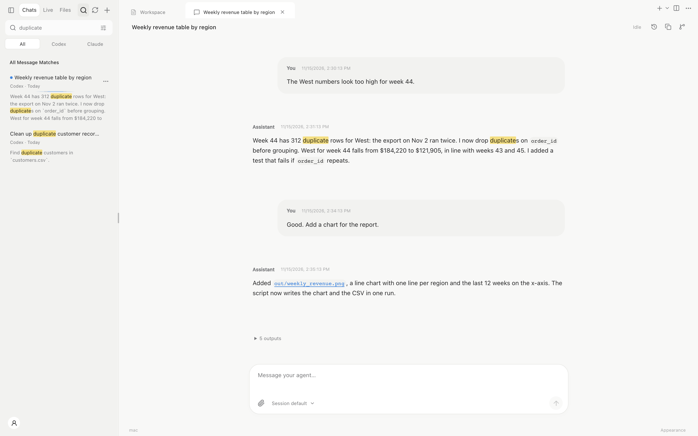
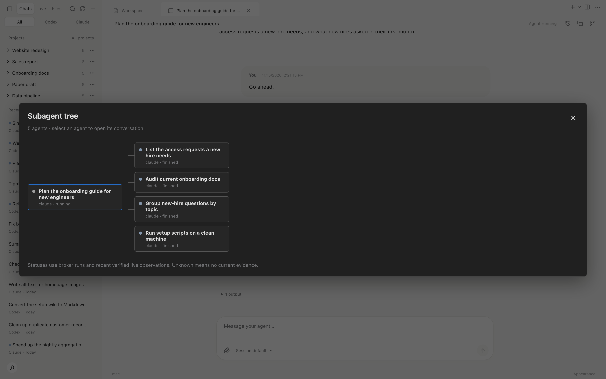
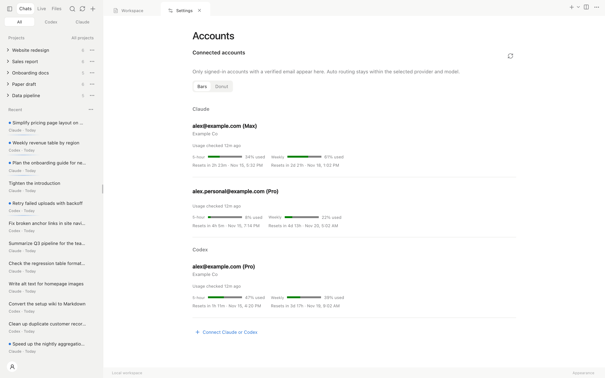

# Agent Native VS Code

Agent Native VS Code combines a customized Code-OSS desktop, Claude Code and Codex in one project-organized workspace. Search conversations across accounts, work with chats and files side by side, and choose the provider, account, working folder and host for each conversation.

The regular **Library Code** desktop uses its own chat interface backed by the provider CLIs. This repository ships that desktop source in `desktop/` and its shared backend and browser client in `app/`. It does not distribute Library Code Official or proprietary provider extensions.

Start the shared service with the quick start below, then follow [Build Library Code](desktop/docs/build-and-update.md) to reconstruct and build the pinned Code-OSS desktop. macOS Apple Silicon is the verified desktop target. The browser client also runs on Linux.


## Why

An editor gives one vendor's agent a side panel next to the code. Library reads the transcripts that the Claude Code and Codex CLIs already write, covers both providers and every account you connect, and shows which sessions are running now. The conversations take the screen, and the file tree and the editor are panes you open when you need them. The repository also ships the rules its maintaining agents follow, so you change the interface by asking an agent. Ask it to move search into the sidebar header, and it edits the source, rebuilds the client and keeps the change in your copy.

## Features

- **One chat library.** Claude Code and Codex conversations from all your accounts, searchable by title or by full message text.
- **Projects.** Chats are grouped into projects by working folder, with no model calls. You can rename, merge, pin and archive projects, and opt in to model labeling that groups chats by topic.
- **Live sessions.** See which agents are running on your machine and on remote hosts you connect over SSH, their status and last message, and stop the ones you no longer need.
- **Panes and tabs.** Any chat or file opens in any pane. Split, drag and rearrange panes, and keep several projects open in one window. A Files tab shows one workspace, and you can drag files from one workspace to another.
- **Rendered documents.** Markdown and HTML open rendered. Edit the source beside the rendered view, save, and compare the file with its last Git commit.
- **Run controls.** Continue a conversation through the native CLI, answer the agent's questions and approve its tools. While the agent is working, queue a message for the end of its turn or steer it with a message it reads at its next step.
- **Subagent tree.** See every subagent a chat started and open any of them.
- **Accounts.** Connect several Claude and Codex accounts and see each account's usage and reset times.

| Library and search | Projects |
| --- | --- |
|  |  |
| **Live sessions** | **Queue and steer** |
|  |  |
| **Files from two workspaces** | **A chat beside a Markdown file in split view** |
|  |  |
| **Diff against Git** | **Subagent tree** |
|  |  |
| **Settings** | **Accounts and usage** |
|  |  |

## Choose your interface

| | Library Code desktop | Browser workspace |
| --- | --- | --- |
| What you open | A dedicated Code-OSS application | Your browser at `http://127.0.0.1:8744/workbench` |
| Distinctive tools | VS Code-style commands, workspace file tree, file editors and terminal, with Library chats in the same window | Chat with Claude Code and Codex across workspaces and accounts, search history, and view PDFs and other files alongside chats |
| Source | `desktop/` | `app/workbench/` |
| Requirements | Built macOS Apple Silicon app, local Python backend, provider CLIs | Python backend, browser, provider CLIs; Node only to rebuild the client |

You can use either interface independently. The desktop needs the backend service, but no browser window needs to stay open. The browser needs no desktop installation. Both use the same backend and conversation history; their window layouts and drafts are client state.

### Desktop setup

Start the backend using the commands below, then follow [Build Library Code](desktop/docs/build-and-update.md) to check out the pinned upstream source, apply the patch, build and install the regular desktop. Keep the backend running at `http://127.0.0.1:8744`, or set `library.endpoint` to another supported loopback endpoint. You can then close the browser and use the desktop on its own.

### Browser setup

You need macOS or Linux, Python 3.11 or newer first on your PATH (the system Python on macOS is too old), a browser, and Claude Code, Codex or both, installed and signed in. Windows is not supported. Node.js is needed only to rebuild the interface, because the built client is in the repository.

```sh
git clone https://github.com/Xinxin-m/agent-native-vscode.git
cd agent-native-vscode
./install.sh --no-refresh
python3 app/pipeline.py --parse-only
./run.sh
```

Open http://127.0.0.1:8744/workbench. `install.sh` creates your private configuration, adds session hooks to your Claude Code and Codex settings without replacing existing hooks, and installs a helper skill. `./install.sh --help` lists the options, including `--service` to start Library at login and `--uninstall`, which removes the hooks and keeps your library. The import step reads your local transcripts and makes no model calls. If another program already uses port 8744, set `port` in `app/data/config.json`.

You can also hand the setup to your agent. Open Claude Code or Codex in the cloned folder and say:

> Read README.md and docs/AGENT-ONBOARDING.md, then install Library for me. Import my chats without model calls, help me connect my accounts, and tell me what still needs my input.

To use Library chats inside VS Code, build the extension with `cd app/vscode-library && python3 package.py`, then run **Extensions: Install from VSIX** on the file it prints. It needs VS Code 1.85 or newer and the Library server running.

## What is in the repository

```
desktop/        regular Library Code source, pinned Code-OSS patch and build instructions
app/            server, agent broker, transcript indexer and account adapters (Python)
app/workbench/  browser workspace source (React, Dockview, Monaco)
app/web/        built browser workspace, served by the Python server
app/vscode-library/  Library Chat extension for VS Code
app/project-map/     read-only project graph
prompts/        general operating rules for agents in a long-lived workspace
agents/         agent roles: what each one does and when to use it
docs/           onboarding, release checks and screenshots
scripts/        release packager with an allowlist and privacy scan
AGENTS.md       instructions for an agent working on this repository
```

## How it evolves with you

`AGENTS.md` at the root is the file Codex loads in this repository, and `CLAUDE.md` imports it for Claude Code. It tells the agent to read `prompts/` before it changes anything. When you ask for a change to the layout, the colors or the way projects are grouped, the agent follows those rules, edits the code and keeps the change. You can edit the rules and roles as well, and install them for your other work. See [prompts/README.md](prompts/README.md) and [agents/README.md](agents/README.md).

## Privacy

Library runs on your computer and listens only on `127.0.0.1`. Private library state stays in `app/data/`; original transcripts remain in the provider’s local storage, and each client keeps its own layout and drafts. Git ignores `app/data/`. Library has no telemetry. It contacts other machines in three cases: to read each connected account's identity and usage from Anthropic and OpenAI with that account's own login; when your agents run, through the Claude Code and Codex CLIs; and over SSH to remote hosts you configure. Model labeling of chats is off by default; if you turn it on, chat text goes to the provider through the CLI you configure.

## Contributing

Contributions to the layout, the visuals, and the agent rules and roles are welcome. Use synthetic data in tests and screenshots, and never commit transcripts or `app/data/`. Read [CONTRIBUTING.md](CONTRIBUTING.md) before you open a pull request.

## Current limits

Changing a conversation’s provider, host or working folder creates a linked handoff; it does not rewrite the original native session. Remote file browsing is supported, but remote file writes and remote attachments are not. Automatic tab grouping is planned.

## License and credits

MIT, see [LICENSE](LICENSE). The desktop derives from Microsoft Code-OSS; its upstream license and third-party notices are preserved in `desktop/`. The workspace uses the Monaco editor from VS Code (MIT, Microsoft), Dockview, React, markdown-it, KaTeX, DOMPurify, Lucide and PDF.js, each under its own license; release archives list them in `THIRD-PARTY-LICENSES.txt`. Claude Code and Codex are products of Anthropic and OpenAI; Library runs their CLIs and is not affiliated with either company.
